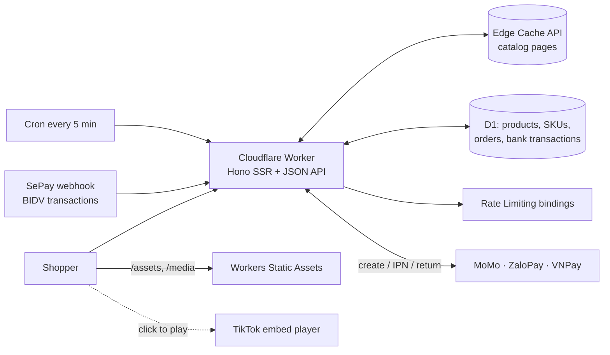

# Mall of Anitoy – Cloudflare storefront

Online shop for the TikTok seller **[Mall of Anitoy (@leduyenminh)](https://www.tiktok.com/@leduyenminh)**, running entirely on Cloudflare. Products, photos and videos are cloned from the shop's TikTok Shop listings and TikTok videos; **orders and payments happen on this site**, not on TikTok Shop.

- **Catalog cloned from TikTok Shop** – `npm run import` reads each listing page (title, description, specifications, photos, SKUs, price, list price, stock, rating, units sold) and downloads the photos into `public/media/p`. Video covers come from TikTok's public oEmbed API.
- **TikTok videos** play in TikTok's official embed player (loaded only on tap, so pages stay fast). Each product shows its videos and view counts.
- **Payments**: COD, **VietQR** bank transfer straight into the shop's **BIDV** account (with optional automatic confirmation through SePay), **MoMo**, **ZaloPay** and **credit/debit cards** (VNPay, or ZaloPay's card gateway).
- **Four themes**: Light, Dark, **Windows 95** (bevelled windows, title bars, taskbar with Start menu and clock) and **Frutiger Aero** (sky, bubbles, glass, glossy buttons). Follows the system light/dark by default; the choice is remembered and applied before first paint.
- **E-commerce UX** in the style of Thế Giới Di Động / Shopee: big search, category bar, category tiles, best-seller rail, free-shipping meter, quick add, cart drawer, sticky mobile buy bar, bottom navigation on phones, guest checkout with the 34 provinces in force since 1 July 2025, order tracking and "Tra cứu đơn hàng".
- **SEO**: server-rendered HTML, clean Vietnamese URLs, canonical links, Open Graph, JSON-LD (OnlineStore, WebSite + SearchAction, Product / ProductGroup with offers, shipping and return policy, BreadcrumbList, ItemList, FAQPage, VideoObject), `sitemap.xml` with images, `robots.txt`, and a **Google Merchant Center feed**.
- **Spam protection**: rate limits on the order, lookup and status APIs, per-phone and per-IP order caps, a honeypot field, optional Cloudflare Turnstile, and **unconfirmed orders expire** so they stop holding stock.

Colour scheme: jade green + saffron, deliberately unlike TikTok's black, pink and cyan.

## Architecture



| Concern | How |
| --- | --- |
| Runtime | One Worker (`src/index.tsx`, Hono with JSX server rendering). Client script is small vanilla JS in `public/assets`. |
| Data | D1. The schema migrates itself on first request (`src/lib/db.ts`) and the catalog is seeded from `src/data/catalog.json`. |
| Stock | An order and its stock decrement are one D1 batch; `CHECK (stock >= 0)` aborts an oversell. Cancelling or expiring an order returns stock in the same transaction, guarded so a lost race never restocks twice. |
| Pricing | The server re-prices every cart (`buildQuote`) and again when the order is placed; client prices are only used to flag changes. |
| Order state | Optimistic locking (`version`) on every write; history is append-only. |
| Payments | An order is paid only after the gateway signature verifies and the amount equals the order total. Callbacks are idempotent. |
| Caching | Catalog pages are cached at the edge, keyed by build and catalog version (seller edits show within ~30 s). Order, cart, checkout and admin pages are `no-store` and `noindex`. Static files get long-lived cache headers (`public/_headers`). |
| Privacy | Order pages need the random token in their link; lookup returns masked name and phone only; logs carry ids and amounts only; IPs are stored as salted hashes. |

## Run locally

Requirements: Node.js 24.22+ (or 22.23+).

```bash
npm install
```

```bash
cp .dev.vars.example .dev.vars
```

Set `ADMIN_PASSWORD` in `.dev.vars`, then:

```bash
npm run dev
```

Open http://localhost:5173. Back office: http://localhost:5173/admin (user `admin`). Development uses a fake bank account so VietQR can be tested; local data lives in `.cloudflare/state/`.

| Command | What it does |
| --- | --- |
| `npm run check` | Typecheck + unit tests |
| `npm run import` | Re-clone listings from TikTok Shop into `src/data/catalog.json` and `public/media` |
| `npm run build` | Production build into `.cloudflare/output/v0` |
| `npm run deploy` | Build and deploy with `cf deploy` |

To test the order-expiry cron locally, open `http://localhost:5173/cdn-cgi/local/scheduled`.

## Deploy to Cloudflare

This project uses the `cf` CLI (`cloudflare.config.ts`), not Wrangler.

1. **Sign in:** `npx cf auth login`.
2. **Set your public settings** in `cloudflare.config.ts`:
   - `BANK_ACCOUNT_NO` and `BANK_ACCOUNT_NAME` – your **BIDV** account number and the account holder name exactly as the bank shows it (upper case, no diacritics). VietQR appears at checkout once both are set.
   - `SITE_URL` – your domain, e.g. `https://anitoy.vn` (used for canonical URLs, the feed and gateway return URLs).
   - `CONTACT_PHONE` / `CONTACT_EMAIL` / `CONTACT_ZALO`, shipping fee, free-shipping threshold, delivery time, `RETURN_DAYS`, and the order expiry times if you want other values.
3. **Create a secrets file** (never commit it), e.g. `secrets.prod.env` with `ADMIN_PASSWORD=…` and any gateway keys from `.dev.vars.example`.
4. **Deploy:**

   ```bash
   npx cf deploy --secrets-file secrets.prod.env
   ```

   `cf deploy` creates the D1 database `anitoy-mall` and the rate limiters on the first deploy. The tables are created and the catalog is seeded on the first request.
5. **Custom domain:** add the domain to Cloudflare and attach it to the Worker (Workers & Pages → anitoy-mall → Settings → Domains & Routes). The edge page cache works on custom domains (not on `workers.dev`).
6. **Protect `/admin` further (recommended):** put it behind Cloudflare Access (Zero Trust → Access → Applications → self-hosted, path `/admin*` and `/api/admin/*`). Basic auth stays as a second layer.

Optional: set `IMAGE_RESIZING` to `"1"` after enabling Image Transformations on the zone, so photos are served resized as AVIF/WebP.

## Payments and where the money goes

| Method | Provider | Settles to |
| --- | --- | --- |
| COD | the carrier | Cash collected by the carrier, paid out to the shop |
| **VietQR** | NAPAS 247, any banking app | **Directly into your BIDV account** – the QR carries your account, the exact amount and the order code |
| MoMo | MoMo for Business | The bank account registered in the MoMo merchant portal – register your **BIDV** account there |
| ZaloPay | ZaloPay merchant | The bank account registered with ZaloPay – your **BIDV** account |
| Credit / debit card | VNPay (`INTCARD`), or ZaloPay's card gateway | The bank account registered with VNPay / ZaloPay – your **BIDV** account |

Gateway keys go into the secrets file (`MOMO_*`, `ZALOPAY_*`, `VNPAY_*`). The endpoints in `cloudflare.config.ts` default to each provider's **sandbox**; switch them to production when your merchant accounts are approved. Register these callback URLs with the gateways:

- MoMo IPN: `https://<domain>/api/payments/momo/ipn` (sent with every request)
- ZaloPay callback: `https://<domain>/api/payments/zalopay/ipn` (sent with every request)
- VNPay IPN: `https://<domain>/api/payments/vnpay/ipn` (set in the VNPay merchant portal)

### Automatic VietQR confirmation (SePay)

Without it, you mark VietQR orders paid in `/admin` after checking your BIDV app. To confirm automatically:

1. Create a [SePay](https://sepay.vn) account and link your BIDV account.
2. Add a webhook to `https://<domain>/api/webhooks/sepay` with **API Key** authentication.
3. Put the key in your secrets file as `SEPAY_API_KEY` and redeploy.

Incoming transfers are matched by the order code in the transfer memo and the exact amount; each transaction is processed once.

## Spam protection and order expiry

| Layer | Default |
| --- | --- |
| Place order | 5 per minute per IP (Rate Limiting binding) |
| Order lookup | 10 per minute per IP |
| Quote / status / payment retry | 60 per minute per IP |
| Open orders per phone number | 3 unpaid, unconfirmed orders at a time |
| Orders per network | 8 per hour per (hashed) IP |
| Bots | Hidden honeypot field; optional Turnstile (`TURNSTILE_SITE_KEY` + `TURNSTILE_SECRET_KEY`) |

Unpaid orders that the seller has not confirmed are **cancelled automatically and their stock released** by a cron every 5 minutes: wallet and card orders after 30 minutes, VietQR after 6 hours, COD after 24 hours (`ORDER_TTL_*`). Confirming a COD order or marking an order paid in `/admin` stops the clock. A payment that arrives after an order expired is still recorded and flagged in the order history for a refund or re-open.

## Catalog from TikTok Shop

`data/listings.json` lists the TikTok Shop product ids plus merchandising (slug, collection, category, tags, featured order, related video ids). Then:

```bash
npm run import
```

Deploy, then in `/admin → Sản phẩm` click **Cập nhật nội dung** (keeps your prices and stock) or **Cập nhật cả giá & tồn kho từ TikTok**. Listings that can't be read keep their previous data.

- The shop has **20 products** on TikTok Shop; the 9 linked from its videos are imported. Add the other listing ids to `data/listings.json` (the long number at the end of each listing URL) and run the import again.
- Prices imported are TikTok's current prices (including TikTok's own promotions), and the struck-through price is the listing's regular price on TikTok. Adjust them in `/admin` if your website prices differ.
- Website stock is separate from TikTok stock. Re-import with prices and stock when you restock, or edit stock in `/admin`.
- Three items appear in videos without a TikTok Shop listing (Frieren 20cm, Osakana sitting, Kimetsu). They are imported as hidden **drafts** with photos from the video covers; set a price and stock in `/admin`, then switch them to **Đang bán**.
- TikTok ratings and units sold are shown with "trên TikTok Shop" attribution and are **not** put into structured data as this site's reviews.

## Google Merchant Center and SEO

1. Verify the domain in [Google Search Console](https://search.google.com/search-console) and submit `https://<domain>/sitemap.xml`.
2. In [Merchant Center](https://merchants.google.com) (country Vietnam), verify and claim the website.
3. Set **shipping** to match the site (Vietnam, VND, 30.000đ flat, free from 150.000đ, 2–5 days) and the **return policy** to match `RETURN_DAYS` (0 = no returns except damaged items).
4. **Products → Add products → Add from a file → file link**: `https://<domain>/feeds/google.xml`, language Vietnamese, currency VND, daily fetch.
5. Turn on free listings and automatic item updates. Check **Needs attention** after the first fetch.

The feed has one item per SKU (variants share `item_group_id`), with real stock (`in_stock` / `out_of_stock`), images and shipping. Product pages carry matching `Product` / `ProductGroup` JSON-LD.

## Project structure

```
cloudflare.config.ts     Worker, D1, rate limiters, cron, public settings
data/                    listings.json (TikTok Shop ids + merchandising), videos.json
scripts/import-tiktok.mjs  clones listings and photos from TikTok Shop
public/                  assets (CSS, JS), media (product photos, video covers), _headers
src/index.tsx            routes, edge cache, security headers, admin auth, payment callbacks, cron
src/lib/                 db (D1), orders, quote, payments (MoMo, ZaloPay, VNPay, VietQR, SePay),
                         limits, seo (JSON-LD, feed, sitemap), catalog, config, validation
src/views/               layout, components, pages (home, listing, product, checkout, order, info, admin)
```
